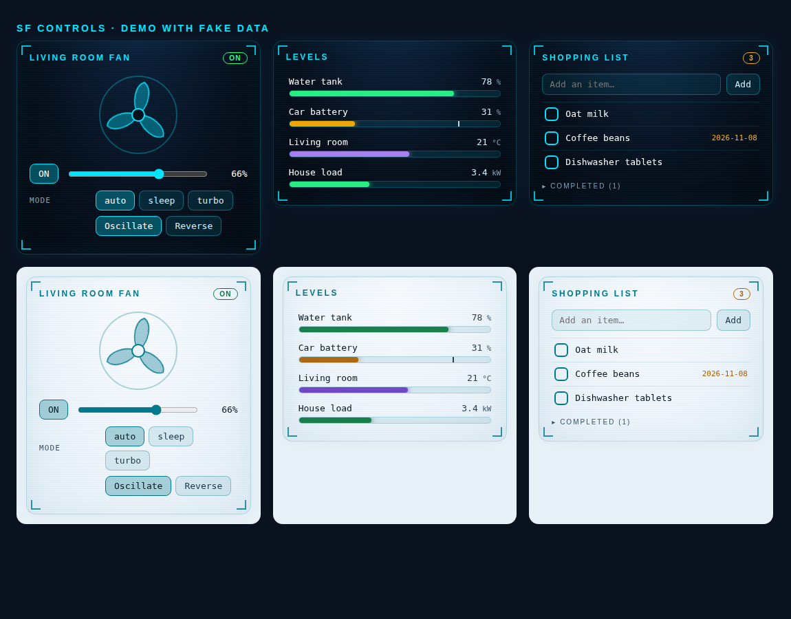

# SF Controls

**The three cards Home Assistant users keep asking for** — a proper **fan** card, a **bar gauge** card and a **to-do** card — in the HUD style of [SF Cards](https://github.com/khrom06/SF-Cards).

[](https://hacs.xyz)
[](LICENSE)
[](https://my.home-assistant.io/redirect/hacs_repository/?owner=khrom06&repository=SF-Controls&category=dashboard)

<p align="center"></p>

## Install

1. HACS → ⋮ → *Custom repositories* → add `https://github.com/khrom06/SF-Controls`, category **Dashboard**; install.
2. Reload the browser (HACS registers the resource for you).

All cards: light/dark theme (`theme: auto | dark | light`), languages en, fr, es, de, nl, it, pt, pl, ru, zh, ar (RTL for Arabic; `language: xx` forces one), keyboard accessible, no dependencies.

## `sf-fan-card`

An animated rotor whose speed follows the fan's speed, a speed slider that respects the fan's `percentage_step`, preset-mode buttons, and oscillation / direction toggles. Controls the fan does not support are hidden.

```yaml
type: custom:sf-fan-card
entity: fan.living_room
name: Living room fan     # optional
```

* Dragging the slider is local until you release it; a state update arriving mid-drag does not rebuild the control under your finger.
* Slider to 0 turns the fan off.

## `sf-bar-card`

Horizontal bar gauges for one or several entities, with severity colours and an optional target marker.

```yaml
type: custom:sf-bar-card
title: Levels
min: 0
max: 100
entities:
  - entity: sensor.water_tank
    severity:                       # the band with the highest `from` <= value wins
      - { from: 0,  color: red }
      - { from: 25, color: amber }
      - { from: 50, color: green }
  - entity: sensor.car_battery
    target: 80                      # draws a marker
  - entity: sensor.living_room_temperature
    min: 10
    max: 30
    color: violet                   # cyan | green | amber | red | violet | grey | #rrggbb
  - { entity: sensor.tank, attribute: level, unit: L, decimals: 2, name: Tank }
```

Missing or unavailable entities are shown as text, never as a broken bar. Colours are validated, so a config value cannot inject CSS.

## `sf-todo-card`

Add, check off and clear items of any `todo.*` entity (shopping list, local to-do, …).

```yaml
type: custom:sf-todo-card
entity: todo.shopping_list
title: Shopping        # optional
```

* Completed items are collapsed under a counter; *Clear completed* appears when expanded.
* The list is read with `todo.get_items` on load and after a change, at most once every 3 s, so many state updates cannot cause a query storm.
* Item text is HTML-escaped.

## Tests

```bash
./test/run.sh   # build check + 535 render checks in headless Chrome
```

---

> **Made by Claude.** Designed and written by Claude (Anthropic's AI) working with its human partner. MIT licensed.
